# Diagrama completo de classes

O diagrama abaixo representa a estrutura atual dos pacotes, incluindo
atributos, métodos públicos/protegidos/privados, membros estáticos,
generalização, realização de interface, composição e dependências.

```mermaid
classDiagram
    direction TB

    namespace modelo {
        class Conta {
            -Titular titular
            -RepositorioTransacoes~Transacao~ transacoes
            -BigDecimal saldo
            +Conta(Titular titular)
            +void inserir(Transacao transacao) throws ControleGastosException
            +void atualizar(long id, Transacao nova) throws ControleGastosException
            +void remover(long id) throws ControleGastosException
            -Transacao localizar(long id) throws ControleGastosException
            -void verificarSaldo(BigDecimal novoSaldo) throws SaldoInsuficienteException
            +Titular getTitular()
            +BigDecimal getSaldo()
            +List~Transacao~ listarTransacoes()
        }

        class Titular {
            -String nome
            +Titular(String nome)
            +String getNome()
        }

        class Transacao {
            <<abstract>>
            -long id
            -String nome
            -String descricao
            -BigDecimal valor
            -LocalDate data
            -Categoria categoria
            #Transacao(String nome, String descricao, BigDecimal valor, LocalDate data, Categoria categoria)
            #Transacao(long id, String nome, String descricao, BigDecimal valor, LocalDate data, Categoria categoria)
            +TipoCategoria getTipo()*
            +BigDecimal efeitoNoSaldo()*
            #Transacao comId(long id)*
            +final void validar() throws ControleGastosException
            +long getId()
            +String getNome()
            +String getDescricao()
            +BigDecimal getValor()
            +LocalDate getData()
            +Categoria getCategoria()
            +Transacao comIdentificador(long novoId)
            +String exibir()
        }

        class Receita {
            +Receita(String nome, String descricao, BigDecimal valor, LocalDate data, Categoria categoria)
            -Receita(long id, String nome, String descricao, BigDecimal valor, LocalDate data, Categoria categoria)
            +TipoCategoria getTipo()
            +BigDecimal efeitoNoSaldo()
            #Transacao comId(long id)
        }

        class Despesa {
            +Despesa(String nome, String descricao, BigDecimal valor, LocalDate data, Categoria categoria)
            -Despesa(long id, String nome, String descricao, BigDecimal valor, LocalDate data, Categoria categoria)
            +TipoCategoria getTipo()
            +BigDecimal efeitoNoSaldo()
            #Transacao comId(long id)
        }

        class Categoria {
            <<enumeration>>
            SALARIOS
            HONORARIOS
            RENDIMENTOS
            OUTRAS_RECEITAS
            MORADIA
            LUZ
            AGUA
            COMUNICACOES
            ALIMENTACAO
            TRANSPORTE
            SAUDE
            EDUCACAO
            LAZER
            OUTRAS_DESPESAS
            -String descricao
            -TipoCategoria tipo
            -Categoria(String descricao, TipoCategoria tipo)
            +String getDescricao()
            +TipoCategoria getTipo()
        }

        class TipoCategoria {
            <<enumeration>>
            RECEITA
            DESPESA
        }
    }

    namespace contratos {
        class Exibivel {
            <<interface>>
            +String exibir()
        }
    }

    namespace repositorio {
        class Repositorio~T~ {
            <<interface>>
            +void adicionar(T item)
            +Optional~T~ buscar(long id)
            +void substituir(long id, T item)
            +void remover(long id)
            +List~T~ listar()
        }

        class RepositorioTransacoes~T~ {
            -LinkedHashMap~Long,T~ itens
            +void adicionar(T item)
            +Optional~T~ buscar(long id)
            +void substituir(long id, T item)
            +void remover(long id)
            +List~T~ listar()
        }
    }

    namespace excecoes {
        class ControleGastosException {
            <<exception>>
            -long serialVersionUID
            +ControleGastosException(String mensagem)
        }

        class ValorInvalidoException {
            <<exception>>
            -long serialVersionUID
            +ValorInvalidoException(String mensagem)
        }

        class NomeInvalidoOuNuloException {
            <<exception>>
            -long serialVersionUID
            +NomeInvalidoOuNuloException(String mensagem)
        }

        class CategoriaNaoDefinidaException {
            <<exception>>
            -long serialVersionUID
            +CategoriaNaoDefinidaException(String mensagem)
        }

        class SaldoInsuficienteException {
            <<exception>>
            -long serialVersionUID
            +SaldoInsuficienteException(String mensagem)
        }
    }

    namespace servico {
        class GeradorIdentificador {
            -long proximoId$
            -GeradorIdentificador()
            +long proximo()$
        }

        class ValidadorTransacao {
            -ValidadorTransacao()
            +void validar(Transacao transacao)$
        }
    }

    namespace app {
        class Main {
            -Main()
            +void main(String[] args)$
        }
    }

    Transacao <|-- Receita
    Transacao <|-- Despesa
    Exibivel <|.. Transacao
    Repositorio~T~ <|.. RepositorioTransacoes~T~
    ControleGastosException <|-- ValorInvalidoException
    ControleGastosException <|-- NomeInvalidoOuNuloException
    ControleGastosException <|-- CategoriaNaoDefinidaException
    ControleGastosException <|-- SaldoInsuficienteException

    Conta "1" *-- "1" Titular : pertence a
    Conta "1" *-- "0..*" Transacao : armazena
    Conta "1" *-- "1" RepositorioTransacoes : utiliza
    Transacao "0..*" --> "1" Categoria : classificada por
    Categoria "0..*" --> "1" TipoCategoria : possui tipo
    Transacao ..> ValidadorTransacao : valida por
    Transacao ..> GeradorIdentificador : gera ID
    Conta ..> ControleGastosException : lança
    Conta ..> SaldoInsuficienteException : verifica
    Main ..> Conta : instancia/coordena
```

## Legenda

- `+` indica membro `public`.
- `-` indica membro `private`.
- `#` indica membro `protected`.
- `$` indica membro `static`.
- `*` indica método abstrato.
- `*--` representa composição.
- `..>` representa dependência de uso.

## Relação com os conceitos do trabalho

- **Herança:** `Receita` e `Despesa` especializam `Transacao`; as quatro
  exceções especializam `ControleGastosException`.
- **Inclusão:** `Conta` armazena uma coleção de referências do tipo
  `Transacao`, contendo objetos `Receita` e `Despesa`.
- **Paramétrico:** `Repositorio<T>` e
  `RepositorioTransacoes<T extends Transacao>`.
- **Interface:** `Transacao` realiza `Exibivel` e
  `RepositorioTransacoes` realiza `Repositorio<T>`.
- **Escopo estático:** `GeradorIdentificador.proximo()` e
  `ValidadorTransacao.validar(...)`.
- **Encapsulamento:** atributos do domínio são privados; construtores
  protegidos e métodos abstratos permitem especialização controlada.
